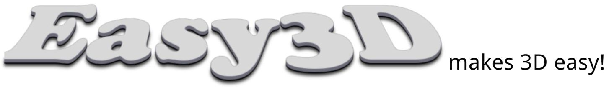
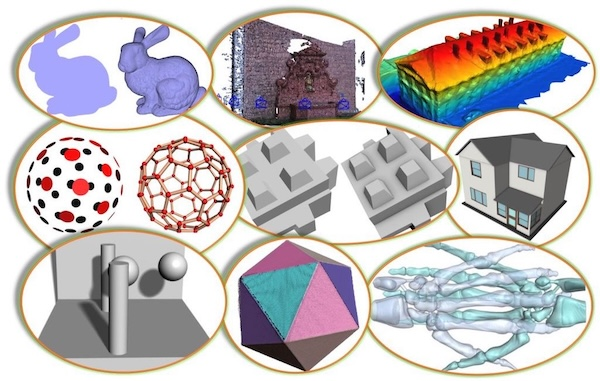
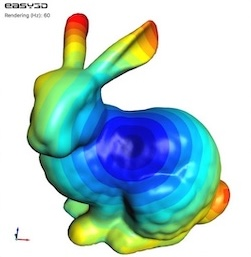
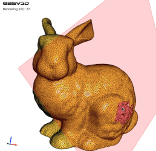

<div align="center">


</div>

<h3 align="center">🔥 <a href="https://github.com/LiangliangNan/Easy3D/blob/main/changes/20261123_release_2.7.0.md">New since v2.7.0</a>: native Vulkan rendering, with OpenGL still supported 🔥</h3>

<div align="right">
    <b></b><br>
    <b></b><br>
    <b></b><br>
</div>



#### A C++ library (with Python bindings) for 3D modeling, geometry processing, and rendering, with native Vulkan support.

Easy3D is designed for simplicity and efficiency. It targets research and education, and also serves as a solid
starting point for sophisticated 3D applications. Unlike geometry processing libraries that focus on algorithms
(e.g., [PMP](http://www.pmp-library.org/) and [libigl](https://github.com/libigl/libigl/)), Easy3D also provides
rendering, a viewer, and user interaction.

<div align="center">



</div>

### Native Vulkan, or OpenGL: your choice
Few visualization libraries ship a native Vulkan renderer. Easy3D does, and keeps OpenGL as an alternative:

* **A real Vulkan backend**, not a wrapper: shaders are compiled to SPIR-V at build time, and it runs on Windows, Linux,
  and macOS (via MoltenVK).
* **One option picks the backend**: `Easy3D_ENABLE_VULKAN` (`ON` by default, `OFF` for OpenGL).
* **One code base for both**: `Viewer`, `MultiViewer`, `OffScreen`, drawables, picking, effects, and snapshots
  share one C++ application API. The tutorials, Python bindings, and Mapple build against either backend;
  Python exposure of the new unified rendering types remains future work.
* **Rendering feature parity**: point/line impostors, ambient occlusion (GTAO), shadow maps, soft shadows (PCSS),
  eye-dome lighting, and four transparency methods (sorted alpha blending, average color blending, depth peeling,
  and per-pixel linked lists). Availability and documented fallbacks depend on the backend and driver; ordinary
  client code does not select a backend or call native graphics APIs.
* **Headless rendering and tests**: offscreen rendering works without a display (for example, on Linux with a
  software Vulkan driver). Interactive viewer tests still require a desktop session.

### Key features
* **Data structures** for point clouds, surface meshes, polyhedral meshes, and graphs, with arbitrary per-element
  properties.
* **Algorithms** such as normal estimation/re-orientation, Poisson reconstruction, RANSAC, simplification, subdivision,
  smoothing, parameterization, remeshing, and hole filling (several taken from [PMP](http://www.pmp-library.org/)).
* **Viewer** based on [GLFW](https://www.glfw.org/), easy to extend, with an optional
  [ImGui](https://github.com/ocornut/imgui) interface
  ([tutorial](tutorials/Tutorial_202_Viewer_imgui)).
* **Mapple**, an ImGui application built on Easy3D for rendering and processing 3D data, running on either backend.
  Its predecessor, the Qt-based Mapple-Qt, is retired and kept for reference (OpenGL only).
* **Python bindings** for either backend.
* **Easy to use as a library**: usually a few lines of code, with 60+ documented
  [C++ tutorials](https://liangliangnan.github.io/Easy3D/examples.html) and
  [Python tutorials](https://liangliangnan.github.io/Easy3D/python/tutorials/).

<div align="center">

|              Scalar field                |              Polyhedral mesh              |              Keyframe animation            |
|------------------------------------------|-------------------------------------------|--------------------------------------------|
|   |  |  |

</div>

### A glance
Any drawable (points, lines, triangles, and thus point clouds, surfaces, scalar fields, and vector fields) takes a few
lines of code. For example, to render a point cloud as spheres or as surfels (3D discs):
```c++
PointsDrawable* drawable = cloud->renderer()->get_points_drawable("vertices");
drawable->set_impostor_type(PointsDrawable::SPHERE);  // or PointsDrawable::SURFEL
drawable->set_point_size(3.0f);
```

### Repository layout
* [`3rd_party`](3rd_party) - third-party libraries.
* [`applications`](applications) - applications built on Easy3D (e.g., Mapple).
* [`cmake`](cmake) - CMake configuration files.
* [`docs`](docs) - documentation sources (Doxygen).
* [`easy3d`](easy3d) - the library:
  [`util`](easy3d/util), [`core`](easy3d/core), [`fileio`](easy3d/fileio), [`kdtree`](easy3d/kdtree),
  [`algo`](easy3d/algo), [`algo_ext`](easy3d/algo_ext) (CGAL-based), [`video`](easy3d/video),
  [`renderer`](easy3d/renderer) (Vulkan and OpenGL backends), [`gui`](easy3d/gui) (picking and interaction), and
  [`viewer`](easy3d/viewer).
* [`python`](python) - Python bindings, documentation, and tutorials.
* [`resources`](resources) - data, images, shaders, textures.
* [`tests`](tests) - test cases.
* [`tutorials`](tutorials) - examples with detailed explanations in code.

### Build
Requirements: [CMake](https://cmake.org/download/) (`>= 3.12`) and a C++11 compiler. Easy3D is tested on macOS
(Xcode >= 8), Windows (MSVC >= 2015 `x64`), and Linux (GCC >= 4.8, Clang >= 3.3). Most third-party libraries are
included in the source tree.

| Backend | CMake option                    | Needs                                                                                  |
|---------|---------------------------------|----------------------------------------------------------------------------------------|
| Vulkan  | `Easy3D_ENABLE_VULKAN=ON` (default) | [Vulkan SDK](https://vulkan.lunarg.com/) to build (on Linux, `libvulkan-dev` and `glslang-tools` suffice); a Vulkan driver to run (MoltenVK on macOS, bundled with the SDK) |
| OpenGL  | `Easy3D_ENABLE_VULKAN=OFF`      | an OpenGL driver                                                        |

A build contains exactly one backend, so use a separate build directory for each.
Consumers can read `Easy3D_BACKEND` (`OpenGL` or `Vulkan`) after `find_package(Easy3D)`, or set
`Easy3D_REQUIRE_BACKEND` before it to fail on a mismatch. Easy3D targets also define
`EASY3D_BACKEND_OPENGL` or `EASY3D_BACKEND_VULKAN` for compile-time checks.

```sh
cd path-to-Easy3D
cmake -S . -B build -DCMAKE_BUILD_TYPE=Release   # add -DEasy3D_ENABLE_VULKAN=OFF for OpenGL
cmake --build build --parallel
```
On Windows, use the `x64 Native Tools Command Prompt` (not `x86`), or open the root `CMakeLists.txt` in an IDE set for
`x64` (e.g., [CLion](https://www.jetbrains.com/clion/)). New to C++? See
[How to build Easy3D step by step](https://github.com/LiangliangNan/Easy3D/blob/main/docs/HowToBuild.md).

Useful options: `Easy3D_BUILD_TUTORIALS` (off by default), `Easy3D_BUILD_TESTS` (off by default),
`Easy3D_BUILD_DOCUMENTATION` (off by default, needs Doxygen), and `Easy3D_ENABLE_CGAL` (off by default; enables advanced surface mesh
algorithms such as self-intersection resolving and clipping/slicing; needs [CGAL](https://www.cgal.org/) 5.1 or later,
and `CGAL_DIR` can point to a specific version).

**Migrating from the OpenGL-only Easy3D (i.e., v2.6.1 or earlier).** Core class names, headers, and the
`virtual void draw() const` hook are unchanged, but there are a few breaking API changes:
- The viewer constructor is `Viewer(title, window, options)`, where `window` is a `WindowOptions` struct (`width`,
  `height`, `samples`, `full_screen`, `visible`, `resizable`) and `options` is an `easy3d::DeviceOptions` value.
  `DeviceOptions` has one public name on both backends: Vulkan builds expose device/validation settings, while
  OpenGL builds expose context-version and buffer-precision requests. Low-level `graphics::RenderDevice` creation
  uses the separate backend-neutral `graphics::DeviceOptions`. Old positional calls such as
  `Viewer(title, 4, 3, 2, false, false)` must be updated.
- `Camera`, `Frame` and related classes now use snake_case method names (e.g., `viewDirection()` became
  `view_direction()`, `showEntireScene()` became `show_entire_scene()`).
- Qt and wxWidgets are no longer supported.

See the [v2.7.0 release notes](https://github.com/LiangliangNan/Easy3D/blob/main/changes/20261123_release_2.7.0.md)
for the full migration table.

**Python bindings:** see the [Python guide](https://github.com/LiangliangNan/Easy3D/blob/main/python/README.md).

**Tests:** configure with `-DEasy3D_BUILD_TESTS=ON`, build, then run
`ctest --test-dir build --output-on-failure`. Tests run for a bounded number of frames without interaction, and the
Vulkan tests require the Vulkan validation layers. See the [test guide](https://github.com/LiangliangNan/Easy3D/blob/main/tests/README.md).

### Use Easy3D in your project
Point `Easy3D_DIR` to your Easy3D build (or installation) directory when running CMake. `CMakeLists.txt`:
```cmake
cmake_minimum_required(VERSION 3.12)
project(MyProject)
set(CMAKE_CXX_STANDARD 11)
find_package(Easy3D COMPONENTS viewer REQUIRED)  # request only the components you need
add_executable(Test main.cpp)
target_link_libraries(Test easy3d::viewer)       # add more modules if needed, e.g., easy3d::algo
```
`main.cpp` (the same code runs on either backend):
```c++
#include <easy3d/viewer/viewer.h>
#include <easy3d/util/initializer.h>

int main(int argc, char** argv) {
    easy3d::initialize();
    easy3d::Viewer viewer("Test");
    return viewer.run();
}
```
Or in Python:
```python
import easy3d

easy3d.initialize()
viewer = easy3d.Viewer("Test")
viewer.add_model(easy3d.resource_directory() + "/data/bunny.ply")  # use your own file path
viewer.run()
```

### Documentation
* [Easy3D documentation](https://liangliangnan.github.io/Easy3D/) and [C++ tutorials](https://liangliangnan.github.io/Easy3D/examples.html)
* [Python documentation](https://liangliangnan.github.io/Easy3D/python) and [tutorials](https://liangliangnan.github.io/Easy3D/python/tutorials/)

### Contributing
Questions, feature requests, bug reports, and contributions are welcome; see the
[Contribution Guide](https://github.com/LiangliangNan/Easy3D/blob/main/CONTRIBUTING.md).

### License
Easy3D is free software, distributed under the terms of the GNU General Public License, version 3 or (at your option)
any later version. See the accompanying [`LICENSE`](https://github.com/LiangliangNan/Easy3D/blob/main/LICENSE) file.

### Acknowledgments
Easy3D benefited from and was inspired by [PMP](http://www.pmp-library.org/),
[libQGLViewer](https://github.com/GillesDebunne/libQGLViewer), and
[Surface mesh](https://opensource.cit-ec.de/projects/surface_mesh). Several surface mesh algorithms (simplification, 
subdivision, smoothing, parameterization, remeshing, hole filling, geodesic distances, fairing, curvatures, 
and triangulation) were taken, with modifications, from PMP. We thank the original authors for their permissive 
licenses, and all users and contributors for bug reports, fixes, testing, and feedback.

### Citation
If you use Easy3D in scientific work, please cite it:

```bibtex
@article{easy3d2021,
  title = {Easy3{D}: a lightweight, easy-to-use, and efficient {C}++ library for processing and rendering 3{D} data},
  author = {Liangliang Nan},
  journal = {Journal of Open Source Software},
  year = {2021},
  volume = {6},
  number = {64},
  pages = {3255},
  doi = {10.21105/joss.03255},
  url = {https://doi.org/10.21105/joss.03255}
}
```

---------

Questions, comments, or suggestions? Contact [Liangliang Nan](https://3d.bk.tudelft.nl/liangliang/) at <i>liangliang.nan@gmail.com</i>.
